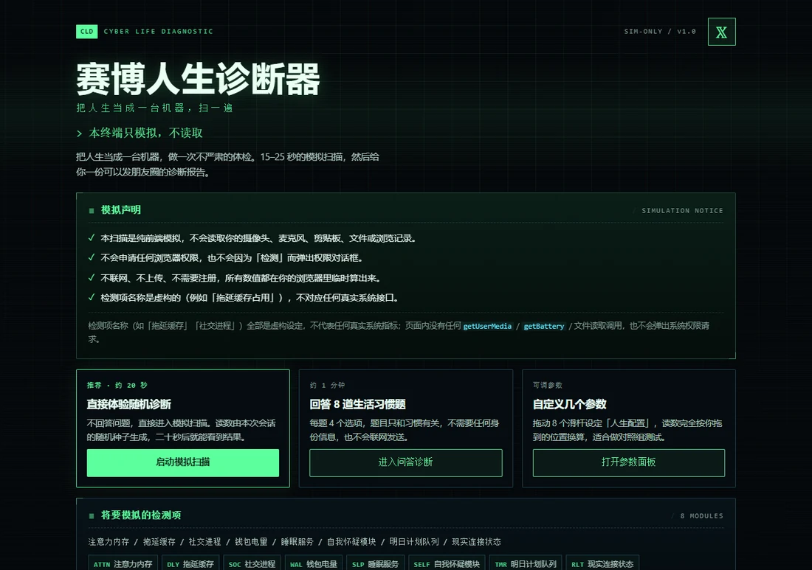
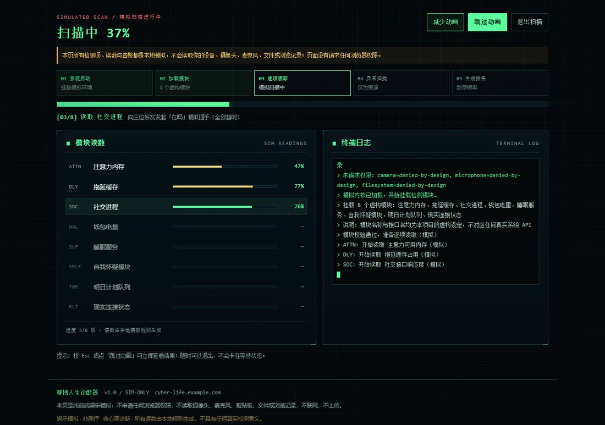
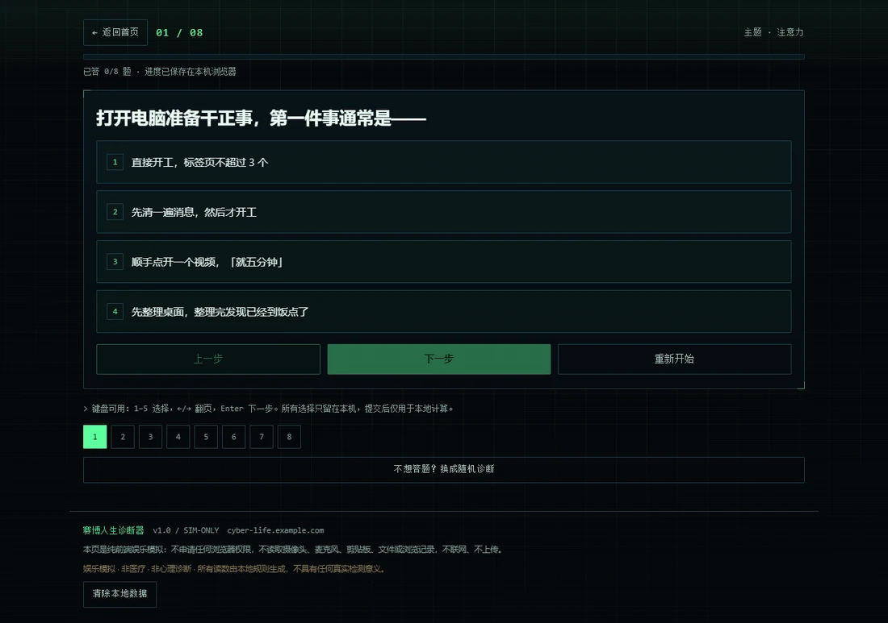
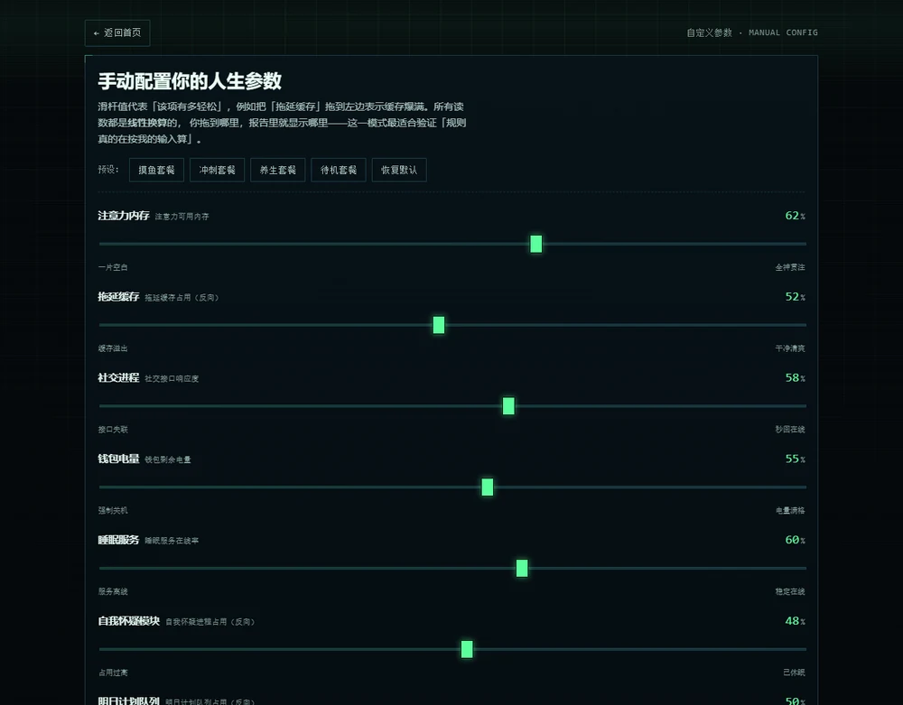
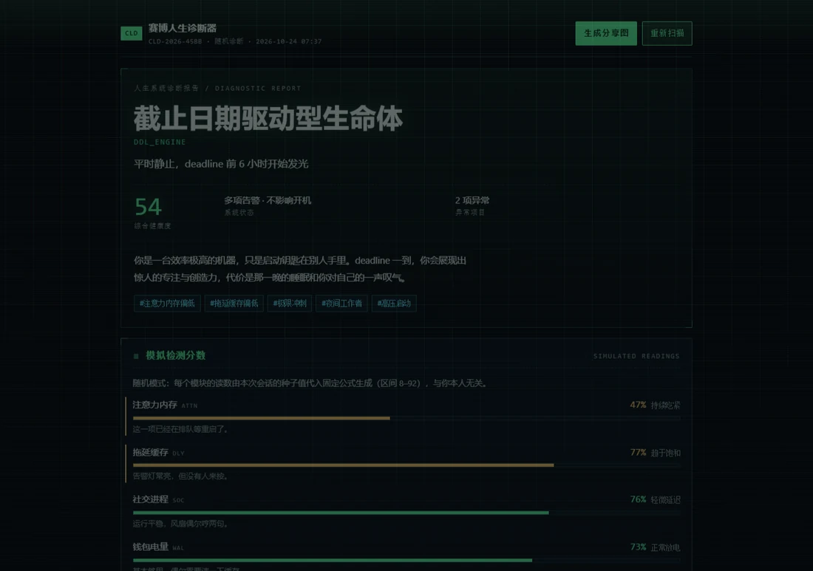
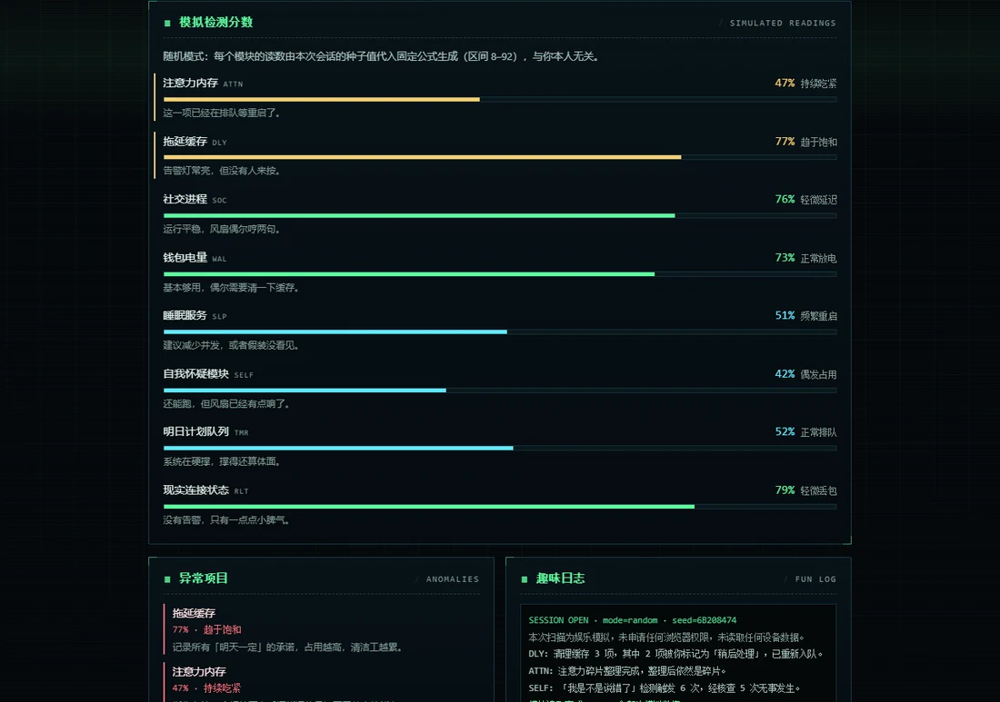
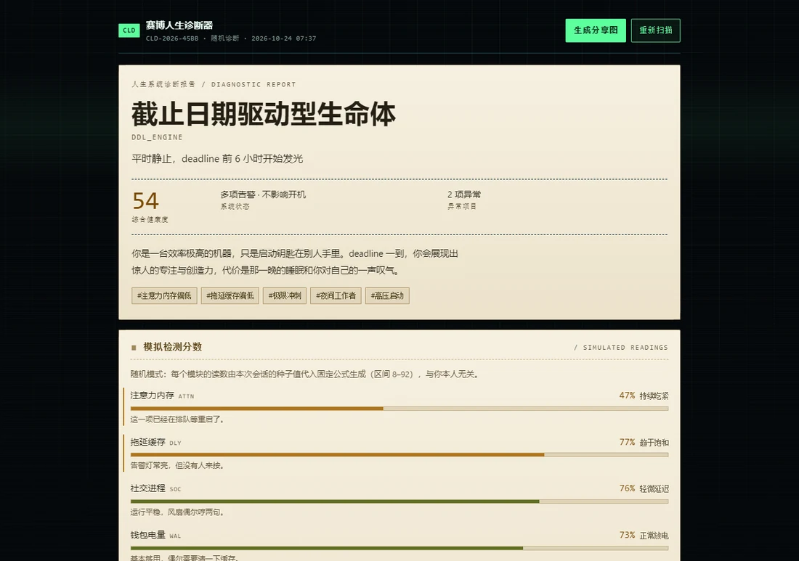
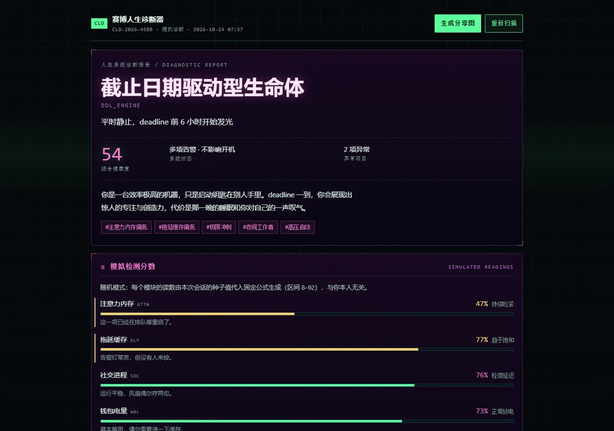
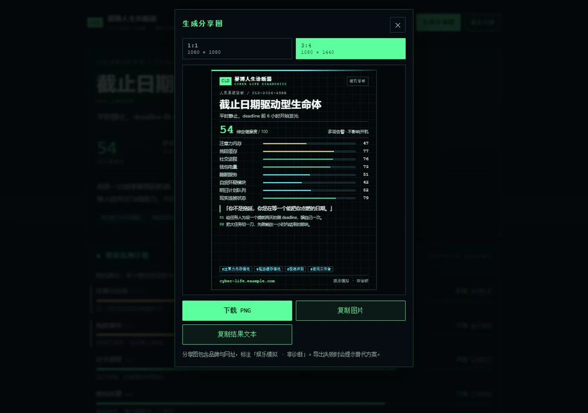

# 赛博人生诊断器 · Cyber Life Diagnostic

> 把人生当成一台机器，做一次不严肃的体检。

[](https://github.com/iiiiiiiiiiiiiKK/cyber-life-diagnostic/actions/workflows/deploy.yml)
[](LICENSE)
[](https://react.dev/)
[](https://vitejs.dev/)
[](https://www.typescriptlang.org/)
[](#-测试与验收)
[](#-隐私承诺不是口号)

---

## 这是什么

一个**纯前端**的娱乐型「人生系统扫描」小站：

点下启动 → 复古终端逐项扫描 15–25 秒 → 生成一份赛博朋克风格的《人生系统诊断报告》→ 导出 1:1 / 3:4 分享图。

检测项全部是虚构的（「拖延缓存占用 78%」「社交接口响应度 41%」），**不读取你的任何真实数据**，
不申请任何浏览器权限，不联网、不上传、不需要注册。

> [!IMPORTANT]
> 本项目是**娱乐内容**，不是心理测评，也不构成任何医疗或心理诊断。
> 所有分数由写死的本地规则 / 你的选择生成，不对应任何真实设备、身体或心理状态。

<p align="center">
  
</p>

---

## 目录

- [快速开始](#-快速开始)
- [核心体验](#-核心体验)
- [扫描流程](#-扫描流程1525-秒)
- [三种输入模式](#-三种输入模式)
- [结果规则](#-结果规则)
- [8 个虚构检测模块](#-8-个虚构检测模块)
- [16 种结果类型](#-16-种结果类型)
- [分享与复玩](#-分享与复玩)
- [技术架构](#-技术架构三层分离)
- [隐私承诺（不是口号）](#-隐私承诺不是口号)
- [无障碍与配色](#-无障碍与配色)
- [测试与验收](#-测试与验收)
- [部署](#-部署)
- [已知限制](#-已知限制)
- [支持作者](#-支持作者)

---

## 🚀 快速开始

```bash
npm install     # Node.js ≥ 18（开发用 Node 24 验证）
npm run dev     # → http://127.0.0.1:5178/
npm run build   # 产出 dist/
npm run preview # 预览构建产物 → http://127.0.0.1:4180/
```

生产依赖只有三个：`react`、`react-dom`、`html-to-image`。没有后端、没有数据库、没有环境变量。

---

## ✨ 核心体验

| 你能做的 | 说明 |
| --- | --- |
| 🎲 **随机诊断** | 不回答任何问题，直接进扫描，20 秒拿结果 |
| 📝 **问答诊断** | 8 道生活习惯题，选项真的会影响每一项读数 |
| 🎛️ **自定义参数** | 拖动 8 个滑杆，读数线性换算，拖到哪显示哪 |
| ⏭️ **跳过动画** | 随时跳过，结果与完整播放**完全一致** |
| 🚪 **中途退出** | 退出扫描回首页，不卡死、不残留计时器 |
| 🔁 **重新扫描** | 同输入重扫 = 完全一致的结果（可自查规则） |
| 🎨 **3 套报告风格** | 经典终端 / 机密档案 / 霓虹广播 |
| 🖼️ **分享图导出** | 1080×1080 与 1080×1440，中文完整、品牌标注 |
| 📋 **复制结果** | 纯文本 / Markdown 两套格式 |

<p align="center">
  
  <br />
  <sub>扫描页：5 个阶段 · 模块读数逐个点亮 · 终端日志实时滚动</sub>
</p>

---

## ⏱ 扫描流程（15–25 秒）

| 阶段 | 内容 | 正常时长 |
| --- | --- | --- |
| `01` 系统启动 | 挂载模拟环境，打印「未请求任何权限」 | ~1.7 s |
| `02` 加载模块 | 列出 8 个虚构模块，声明名称虚构 | ~1.5 s |
| `03` 逐项读取 | 8 个模块 × (读取 + 校验) = 16 步 | ~9.1 s |
| `04` 异常归类 | 汇总异常项 `SIM-ALERT`，强调「仅为表演」 | ~2.6 s |
| `05` 生成报告 | 匹配结果类型、封存编号 | ~1.9 s |
| **合计** | **20 个步骤** | **≈ 16.8 s** |

实现要点：

- **唯一时间源** —— 一个 `requestAnimationFrame` 累加 `elapsed`，所有 UI 由纯函数 `stepAt()` / `progressAt()` 推导。
- **单帧上限 90ms** —— 切走标签页再回来不会「瞬移」。
- **一定有终点** —— 到点即 `finished`，另有 `total + 8s` 看门狗，rAF 被暂停也会强制收尾。
- **跳过 = 直达终点** —— 结果对象在进扫描页前就算好了，跳过与播放结果一致。
- **减少动画** —— 压缩到 ≈3.8s，并关闭扫描线、光束、故障闪烁、打字机、所有 transition。
- **重复点击** —— 扫描页以 `key` 重挂载，`跳过`/`开始` 幂等（E2E 有连点三次用例）。

---

## 🎯 三种输入模式

| 模式 | 输入 | 读数怎么来的 |
| --- | --- | --- |
| **随机** | 无 | 显式种子 → mulberry32 → 每模块两次采样取均值 → 映射到 8–92 |
| **问答** | 8 题 × 4 选项 | 各模块健康度基准 50，按选项增量累加，夹到 8–94 |
| **自定义** | 8 个滑杆（0–100） | 滑杆值 = 健康度，线性换算（反向模块取 `100 - health`） |

<p align="center">
  
  
</p>

- 不要求注册，不问年龄、性别、职业、住址。
- 问答进度按题存 `localStorage`，刷新后**恢复到第一道未答题**（不是回到上次题号）。
- 题库版本变化（`QUESTION_SET_VERSION`）会让旧进度主动失效，避免答案对不上题。
- 自定义模式带 4 套预设：摸鱼 / 冲刺 / 养生 / 待机，并实时预览换算后的读数。

---

## 📊 结果规则

### 计算链路

```
输入（种子 / 答案 / 滑杆）
      ↓
各模块健康度（0–100，越大越轻松）
      ↓
读数 = invert ? 100 - health : health     ← 报告上显示的数字
      ↓
综合健康度 = Σ(健康度 × 权重)              ← 权重和为 1
      ↓
按 ARCHETYPES 顺序匹配，第一个全部满足的类型胜出；最后一个无条件兜底 → 一定出结果
      ↓
报告对象（编号 / 状态 / 读数 / 异常 / 日志 / 标签 / 结论 / 建议）
```

同一输入**永远**得到同一结果（含编号 `CLD-YYYY-XXXX`）。报告页的「用同样输入重新扫描」可验证这一点。

### 报告包含

- **系统状态** —— 按综合健康度分 5 档（运行良好 → 系统过载）
- **8 项模拟检测分数** —— 含档位、一句话评语、彩色进度条
- **异常项目** —— 只收「告急 / 异常」两档，最多 4 项，按严重度排序
- **趣味日志** —— 会话行 + 3 条模块日志 + 归档行 + 封存行
- **一句最终结论** + **三条轻松的行动建议**
- **趣味标签** —— 来自所选选项 + 结果自带，上限 6 个

<p align="center">
  
</p>

<p align="center">
  
  <br />
  <sub>档位色只作用于进度条填充，文字永远留在深色底上 —— 这是对比度审计强制的结果</sub>
</p>

---

## 🧩 8 个虚构检测模块

| 代号 | 名称 | 读数含义 | 方向 | 权重 |
| --- | --- | --- | :---: | :---: |
| `ATTN` | 注意力内存 | 注意力可用内存 | 越大越好 | 0.20 |
| `DLY` | 拖延缓存 | 拖延缓存占用 | 越大越糟 | 0.16 |
| `SOC` | 社交进程 | 社交接口响应度 | 越大越好 | 0.13 |
| `WAL` | 钱包电量 | 钱包剩余电量 | 越大越好 | 0.10 |
| `SLP` | 睡眠服务 | 睡眠服务在线率 | 越大越好 | 0.13 |
| `SELF` | 自我怀疑模块 | 自我怀疑进程占用 | 越大越糟 | 0.13 |
| `TMR` | 明日计划队列 | 队列占用 | 越大越糟 | 0.08 |
| `RLT` | 现实连接状态 | 现实世界连接质量 | 越大越好 | 0.07 |

每个模块 5 个档位（`ok / note / warn / bad`），反向后统一成「健康度」参与加权。

> [!NOTE]
> 这些名字**全部是虚构设定**，不对应任何真实系统接口。本项目从未调用
> `navigator.getBattery`、`navigator.mediaDevices`、`navigator.geolocation` 等能力。

---

## 🎭 16 种结果类型

<details>
<summary><b>点开看全部 16 种（按匹配优先级排序）</b></summary>

| # | 结果名称 | 代号 | 触发条件（摘要） |
| :-: | --- | --- | --- |
| 1 | 内存不足型人生 | `ERR_ATTN_OOM` | 注意力 ≤42 且 拖延 ≥55 |
| 2 | 多线程过载型人格 | `ERR_THREAD_UM` | 拖延 ≥68 且 队列 ≥60 |
| 3 | 明日计划堆积型系统 | `QUEUE_FULL` | 队列 ≥66 且 拖延 ≥50 |
| 4 | 社交接口不稳定 | `NET_SOC_TMO` | 社交 ≤42 且 自我怀疑 ≥56 |
| 5 | 情绪进程占用过高 | `SELF_HIGH_CPU` | 自我怀疑 ≥66 且 睡眠 ≤62 |
| 6 | 现实连接正常但响应缓慢 | `RLT_HIGH_PING` | 现实 28–46 且 注意力 ≥62 |
| 7 | 钱包低电量模式 | `WAL_LOW_BAT` | 钱包 ≤34 |
| 8 | 睡眠服务离线 | `SLP_OFFLINE` | 睡眠 ≤40 且 注意力 ≤62 |
| 9 | 稳定运行型人生 | `ALL_OK` | 4 项同时达标（≈0.7% 稀有） |
| 10 | 离线漫游型人格 | `RLT_ROAMING` | 现实 ≤34 |
| 11 | 截止日期驱动型生命体 | `DDL_ENGINE` | 拖延 ≥62 且 睡眠 ≤55 且 注意力 ≥45 |
| 12 | 过度编译型人格 | `COMPILE_SLOW` | 社交 ≤60 且 自我怀疑 ≥50 且 注意力 ≥45 |
| 13 | 内容黑洞型系统 | `FEED_INFINITE` | 注意力 ≤58 且 队列 ≥48 且 现实 ≥40 |
| 14 | 静音观察者 | `MUTE_OBSERVER` | 社交 ≤50 且 自我怀疑 ≤45 且 现实 ≥45 |
| 15 | 频繁重启型人生 | `REBOOT_LOOP` | 队列 ≥55 且 自我怀疑 ≥42 且 钱包 ≥30 |
| 16 | 缓冲中的人类 | `BUFFERING` | **无条件兜底** |

</details>

随机模式 8000 次采样的经验分布：最常见 `缓冲中的人类` ≈11%、`钱包低电量模式` ≈11%、
`睡眠服务离线` ≈10%，最稀有 `稳定运行型人生` ≈0.7%。**16 种全部可达**，`npm test` 会校验。

### 3 套报告风格

<p align="center">
  
  
  <br />
  <sub>左：机密档案（米黄纸张 / 深棕字）　右：霓虹广播（暗紫底 / 洋红描边）</sub>
</p>

模板只改配色与边框，不改任何内容或数值；分享卡会跟随当前模板。

---

## 🖼 分享与复玩

<p align="center">
  
</p>

- **两种比例**：1:1 → **1080×1080**、3:4 → **1080×1440**（CSS 360 宽 × `pixelRatio 3`）
- 卡片含品牌（中英文 + CLD 徽标）、编号、结果名称、副标题、综合健康度、读数条、标签、网址与娱乐声明
- 三个工程细节值得一说：
  1. **边框不占尺寸** —— 用 `inset box-shadow` 代替 `border`，否则 `html-to-image` 会把 1px 算进去，导出变成 1086×1086
  2. **中文不裁切** —— 字号按名称长度自适应 + 卡片内部统一 `border-box`；测试用 `Range` 量每个文字节点的字形盒
  3. **真画出来了** —— 对导出的 PNG 做标题区**像素墨迹检测**（4%–60%），确认中文不是空白
- 复制支持纯文本 / Markdown，失败自动提示；移动端支持系统分享，不支持时降级为下载 PNG

---

## 🏗 技术架构（三层分离）

```
data/（内容与阈值）
   ↓
lib/scoring（纯函数：输入 → 读数 → 类型 → 报告）
   ↓
lib/scan（步骤计划：纯数据，无计时器）
   ↓
pages/（React：动画只读计划，不回写结果）
```

```
cyber-life-diagnostic/
├── index.html
├── vite.config.ts               # base:'./' 可部署到任意子路径
├── public/favicon.svg
├── docs/                        # README 用的截图与打赏码
├── src/
│   ├── App.tsx                  # 顶层状态机（只做路由与会话编排）
│   ├── data/                    # ← 数据层：改内容不用碰逻辑
│   │   ├── site.ts              # 品牌 / 隐私声明 / 免责 / 作者 X 链接
│   │   ├── modules.ts           # 8 个模块（权重 / 档位 / 检查项 / 日志素材）
│   │   ├── questions.ts         # 8 道题 + 选项增量
│   │   ├── archetypes.ts        # 16 种结果类型
│   │   ├── custom.ts            # 8 个滑杆 + 4 套预设
│   │   └── templates.ts         # 3 套报告模板
│   ├── lib/                     # ← 规则层：纯函数，可脱离浏览器单测
│   │   ├── scoring.ts           # 评分引擎
│   │   ├── scan.ts              # 扫描计划编排
│   │   ├── share.ts             # 文本序列化
│   │   ├── storage.ts           # localStorage（版本校验 / 坏数据丢弃 / 静默降级）
│   │   ├── image.ts             # 导出 / 下载 / 复制 / 系统分享及降级
│   │   └── testable.ts          # 测试聚合出口（不进生产构建）
│   ├── pages/                   # HomePage / QuizPage / CustomPage / ScanPage / ResultPage
│   ├── components/              # ShareCard / ShareModal / SiteFooter / ErrorBoundary
│   └── styles/                  # global.css / share.css
└── scripts/                     # 开发期测试（不打包进产物）
    ├── selftest.mjs             # 规则层自测（4556 断言）
    ├── e2e.mjs                  # 浏览器 E2E（84 断言）
    ├── verify-share.mjs         # 分享图导出校验（96 张卡）
    ├── layout-audit.mjs         # 布局体检（4 视口 × 5 页面）
    ├── contrast-audit.mjs       # 配色对比度审计（WCAG AA + 埋点自检）
    ├── serve.mjs                # 零依赖静态服务器
    └── share-stress.entry.tsx   # 96 张卡的渲染入口
```

构建体积：JS ≈ 221 KB（gzip ≈ 83 KB），CSS ≈ 39 KB（gzip ≈ 8 KB）。

---

## 🔒 隐私承诺（不是口号）

这些是可以 grep 验证的实现约束：

1. 源码里**没有任何** `getUserMedia` / `getBattery` / `getCurrentPosition` / `showOpenFilePicker` 调用；
   E2E 挂探针，断言设备 API 与 `navigator.permissions.query` 调用次数为 **0**。
2. 页面**不请求**任何摄像头 / 麦克风 / 通知 / 剪贴板权限；也没有「请点击允许」一类诱导文案
   （E2E 用正则断言首页不存在「请允许 / 点击授权 / 开启相机 / 开启麦克风 / 允许访问」）。
3. **没有网络请求** —— 无后端、无统计、无字体 CDN。
4. 告警文案一律带「（模拟）」或「仅为表演」，不使用恐吓表达；`npm test` 扫描全部文案，
   禁止出现「确诊 / 抑郁症 / 癌症 / 寿命」等词。
5. 报告页与分享图都标注「娱乐模拟 · 非医疗 · 非心理诊断」。

---

## ♿ 无障碍与配色

- 黑底 + 荧光绿 + 少量红色告警；等宽字体承载数据，无衬线承载正文。
- 原生 `button`；答题 `role="radiogroup"`；进度条 `role="progressbar"`；日志 `aria-live`；
  分享面板 `role="dialog"` + `aria-modal` + `Esc` 关闭 + 滚动锁定；模板按钮带 `aria-pressed`。
- 键盘全流程可用：`1–5` 选项、`←/→` 翻页、`Enter` 下一题、`Esc` 跳过扫描。
- 触摸目标 ≥ 44px（移动端实测），选项 ≥ 62px，滑杆命中 34px。
- 320px 起无横向滚动。
- **配色对比度策略**：
  - 档位色只作用于进度条填充，文字永远在深色底上（早期版本把档位色铺满整行，对比度只有 1.0–2.4）
  - 辅助文字提亮到 WCAG AA 以上（`--text-faint` 从 3.5 → 5.9）
  - 「机密档案」模板只在面板内换纸色底，页头页脚保持深色主题
  - 由 `npm run test:contrast` 守住：桌面 + 移动 **13 个页面状态**，逐元素算真实对比度
    （含半透明合成与渐变背景），任何一处不达标即失败；脚本还会**故意埋两个缺陷自检**

---

## ✅ 测试与验收

```bash
npm test              # 规则层自测          4556 断言
npm run test:e2e      # 浏览器 E2E          84 断言
npm run test:share    # 分享图导出校验      96 张卡
npm run test:layout   # 布局体检            4 视口 × 5 页面
npm run test:contrast # 配色对比度审计      13 页面状态
npm run test:all      # build + 以上五套
```

浏览器测试用 `puppeteer-core`（**不下载 Chromium**），自动找本机 Chrome/Edge；
测试跑在脚本自起的临时静态服务器上，跑完自动关闭，**不需要手动先开服务器**。

| 套件 | 结果 | 覆盖 |
| --- | :-: | --- |
| `npm test` | ✅ 4556 / 0 | 题库结构、模块定义、16 类型字段与可达性、评分确定性、报告结构、文本导出、扫描计划时间轴、文案安全 |
| `npm run test:e2e` | ✅ 84 / 0 | 完整扫描、跳过、确定性、中途退出、问答、刷新恢复、自定义参数、复制、分享导出（真实落盘 + PNG 头尺寸）、模板切换、重复点击、权限探针、移动端、减少动画、清除数据 |
| `npm run test:share` | ✅ 10 / 0 | 96 张卡（16×2×3）渲染 + 导出 + PNG 解码 + 文字包围盒不越界 + 中文墨迹检测 + 品牌/网址/声明齐全 |
| `npm run test:layout` | ✅ 100 / 0 | 横向溢出、右越界、过小正文、点击目标 ≥44px、JS 错误 |
| `npm run test:contrast` | ✅ 0 不达标 | 逐元素 WCAG 对比度 + 档位色误用 + 标题重叠 + **埋点自检** |

手工验收对照（原始需求第 8 条）：

- ✅ 完整扫描有结束态 ≈17s；跳过扫描立即到同一结果；三种模式均可完成
- ✅ 重新开始 / 切换模式 / 重复点击 / 中途退出 / 刷新恢复均无异常
- ✅ 结果与选择相关：自定义读数与滑杆 1:1 一致（5 个正向 =90、3 个反向 =10）
- ✅ 无虚假权限提示、无真实设备 API 调用（探针 = 0）
- ✅ 手机端无横向溢出（320 / 390 均通过）
- ✅ 导出 1080×1080 与 1080×1440 合法 PNG，中文完整

---

## 🚢 部署

### GitHub Pages（已配置）

推送到 `main` 即自动构建部署，workflow 见 [`.github/workflows/deploy.yml`](.github/workflows/deploy.yml)。

```
https://iiiiiiiiiiiiiKK.github.io/cyber-life-diagnostic/
```

### 其他平台

产物是纯静态文件，`base: './'` 所以**任意子路径都能跑**：

```bash
npm ci && npm run build
# 把 dist/ 整个目录上传即可
```

| 平台 | 配置 |
| --- | --- |
| **Vercel** | Framework `Vite` · Build `npm run build` · Output `dist` |
| **Netlify** | Build `npm run build` · Publish `dist` |
| **Cloudflare Pages** | Build `npm run build` · Output `dist` |
| **Nginx / R2 / 对象存储** | 上传 `dist/` 内容到站点根目录 |

无环境变量、无服务端、无数据库、无密钥。

---

## 📌 已知限制

1. 本项目是**娱乐产品**，结果没有任何心理学 / 医学依据；类型阈值是为了「分布铺开、可区分」调出来的。
2. 分享图依赖 `html-to-image`（SVG foreignObject），极少数老 Safari / 内嵌 WebView 可能导出空白，
   此时面板会提示并建议改用「复制结果文本」或手机截图。
3. 剪贴板图片复制依赖 `ClipboardItem`（Firefox 不支持），自动降级为复制文字。
4. 系统分享（`navigator.share`）需移动端浏览器 + HTTPS，不满足时降级为下载。
5. 未做多语言，界面文案为简体中文硬编码。
6. 未使用路由库，刷新回首页（结果与进度靠 `localStorage` 恢复）；暂无可分享的结果链接。
7. ~~`SITE_URL` 是占位域名~~ —— 已改为真实部署地址 `https://iiiiiiiiiiiiiKK.github.io/cyber-life-diagnostic/`，
   分享图页脚与复制文本都会带上它。若要换域名，只改 `src/data/site.ts` 一处，测试会自动跟随。

---

## 💚 支持作者

如果这个项目让你笑了一下，可以请作者喝杯咖啡 —— 完全自愿，不影响任何功能。

<p align="center">
  
</p>

<p align="center">
  其他想法、bug、想加的结果类型，欢迎来
  <a href="https://x.com/0xkillcoin"><b>𝕏 @0xkillcoin</b></a>
  找我，或者直接开 <a href="https://github.com/iiiiiiiiiiiiiKK/cyber-life-diagnostic/issues">Issue</a>。
</p>

---

## 📄 License

[MIT](LICENSE) © [@0xkillcoin](https://x.com/0xkillcoin)

> 娱乐内容，非心理诊断、非医疗建议。如果你正在经历持续的情绪困扰，请寻求专业心理服务。
